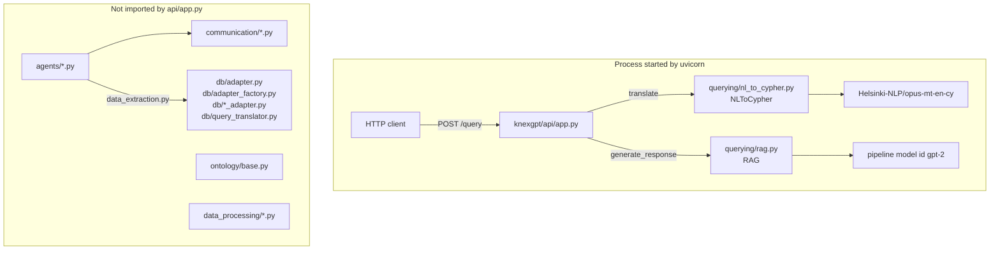
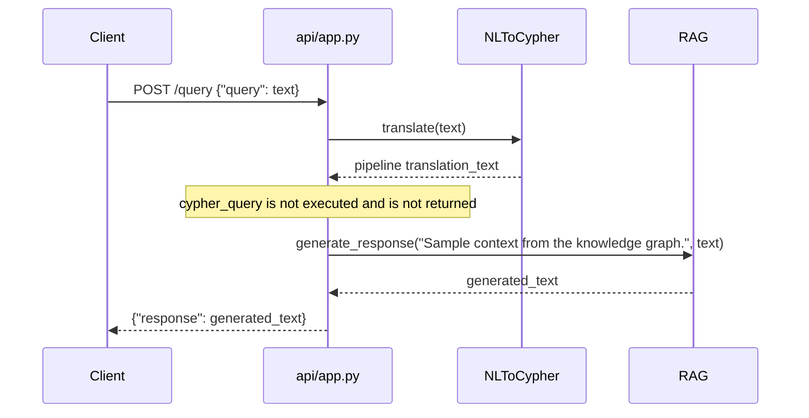
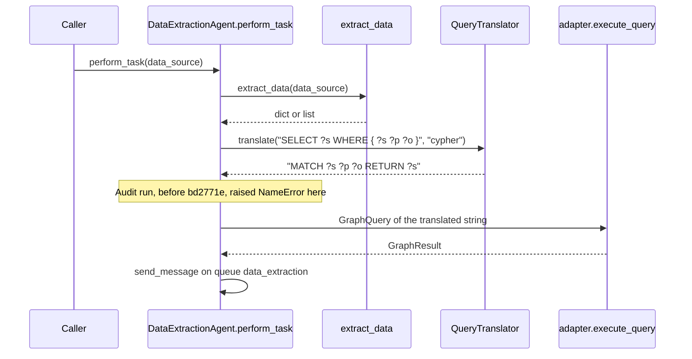
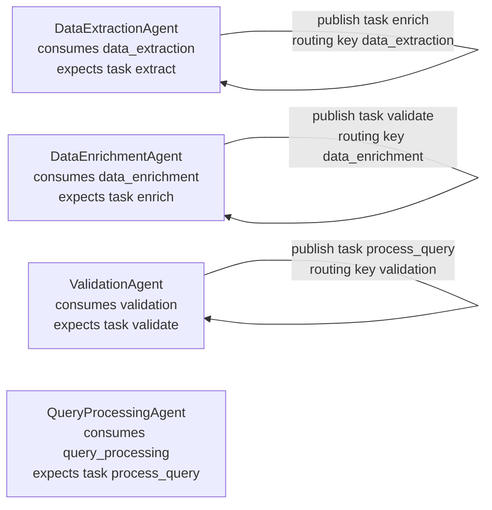

# KnexGPT

KnexGPT is a Python 0.1.0 prototype of a multi-agent knowledge-graph system. The repository contains a one-route FastAPI application, an RDF ontology helper, graph-database adapter classes, RabbitMQ agent classes, and wrappers for third-party text and web tools.

Those parts are not connected into one running system. The only process entry point is `knexgpt/api/app.py`. On `POST /query` it calls a Hugging Face translation pipeline, discards the translation, and returns text from a generation pipeline whose context is a fixed string. It does not query Neo4j, ArangoDB, Neptune, or the ontology.

This document describes the source tree as it is on disk, including the uncommitted edit to `knexgpt/data_processing/chunkr_integration.py`. Behaviour that was executed is marked **Verified**. Behaviour taken from source or from a third-party package, without running that path, is marked **Inspected**. The command log, environment, and defect list are in [`AUDIT.md`](AUDIT.md).

## Purpose

`pyproject.toml` and `knexgpt/__init__.py` describe the project as a multi-agent knowledge-graph system with AI-driven querying and data processing. `.cursor/prd` is a design note for that system: RDF/OWL or SHACL ontologies, Neo4j, ArangoDB, and Amazon Neptune, MetaGPT agents, Chunkr, Firecrawl, retrieval-augmented generation, and a REST or GraphQL API.

The implementation covers only some of those names, and several of the covered names are stubs:

| Design area | In this repository |
| --- | --- |
| HTTP API | One FastAPI route, `POST /query`, in `knexgpt/api/app.py`. |
| Natural language to Cypher | `knexgpt/querying/nl_to_cypher.py` loads `Helsinki-NLP/opus-mt-en-cy`, an English-to-Welsh machine-translation model. The API does not execute or return the translation. |
| Retrieval-augmented generation | `knexgpt/querying/rag.py` runs a `text-generation` pipeline. The API passes the constant `"Sample context from the knowledge graph."` The comment in `app.py` says the context is mocked. |
| Ontology | `knexgpt/ontology/base.py` can add classes and properties to an RDFLib graph and serialize Turtle. `validate()` returns an empty list. Nothing else imports it. |
| Graph databases | Adapter classes exist for Neo4j, ArangoDB, and Neptune. The API does not use them. The factory the extraction agent imports cannot be loaded. |
| Agents | Four `BaseAgent` subclasses read and write RabbitMQ. No module starts them. Enrichment, validation, and query handling return fixed or wrapped values. |
| MetaGPT and LangChain | Declared in `pyproject.toml`. No Python file imports them. |
| Security, SHACL, GraphQL, dashboards | Named in `.cursor/prd`. No implementation. |

## What currently runs

There is no `__main__.py`, no Poetry script entry, and no example script. The Dockerfile and this repository's previous README both start:

```bash
uvicorn knexgpt.api.app:app --host 0.0.0.0 --port 8000
```

Importing `knexgpt.api.app` constructs two pipeline objects at module scope (`rag = RAG()` and `nl_to_cypher = NLToCypher()`). The route then does this:

```python
cypher_query = nl_to_cypher.translate(request.query)
context = "Sample context from the knowledge graph."
response = rag.generate_response(context, request.query)
return {"response": response}
```

`RAG.__init__` calls `transformers.pipeline("text-generation", model="gpt-2")`. `NLToCypher.__init__` calls `transformers.pipeline("translation", model="Helsinki-NLP/opus-mt-en-cy")`. A failed pipeline load prevents the process from serving any route.

**Verified:** in a clean virtualenv without `transformers`, `import knexgpt.api.app` raises `ModuleNotFoundError: No module named 'transformers'`.

**Verified:** the Hugging Face Hub client resolves `gpt2` to `openai-community/gpt2` and resolves `Helsinki-NLP/opus-mt-en-cy`. The same client reports repository not found for the id `gpt-2` used by `knexgpt/querying/rag.py`. Model weights were not downloaded, and generation was not run.

**Verified with a stubbed `transformers.pipeline`:** `POST /query` with `{"query": "who knows whom"}` returns HTTP 200 and:

```json
{"response": "Context: Sample context from the knowledge graph.\nQuery: who knows whom\nResponse: ||GENERATED||"}
```

The stub marker `||GENERATED||` stands in for pipeline output. The real pipeline would be asked to continue that same prompt. The translation string was not present in the JSON. `POST /query` with `{}` returned HTTP 422. `GET /query` returned HTTP 405. `GET /` returned HTTP 404. FastAPI also mounts `/docs`, `/redoc`, and `/openapi.json`. That run used FastAPI 0.159.0, which is outside the `^0.109.0` range in `pyproject.toml`; the status codes above are from that version. The response body is assembled by the three lines in `query_knowledge_graph`.

There is no authentication, no configuration object, and no database client on this path.

## Repository layout

```text
pyproject.toml              Poetry project and dependency declarations
readme.md                   This file
Dockerfile                  Image build. Installs a requirements.txt that is not in the tree
k8s-deployment.yaml         Deployment only. No Service
.cursor/prd                 Design note. Not read by the application
.cursor/s.txt               Coding prompt used when the prototype was generated
knexgpt/__init__.py         Package docstring and __version__ = "0.1.0"
knexgpt/api/app.py          FastAPI application
knexgpt/querying/           Translation and text-generation wrappers
knexgpt/ontology/base.py    RDFLib ontology helper
knexgpt/db/                 Adapter base, Neo4j adapter, ArangoDB, Neptune, SPARQL string rewrite
knexgpt/agents/             Four agent classes
knexgpt/communication/      Two unrelated queue clients
knexgpt/data_processing/    Identity preprocessor, Firecrawl wrapper, Chunkr wrapper
```

`knexgpt/__init__.py` and `knexgpt/agents/__init__.py` are the only package initializers. On Python 3.11.7 the other directories still import as packages. **Verified** for the modules that could be imported; see the import table in [`AUDIT.md`](AUDIT.md).

There is no `tests/` directory, no `requirements.txt`, no `poetry.lock`, no `LICENSE`, and no CI workflow.

## Architecture

Modules in the top band are what `uvicorn knexgpt.api.app:app` loads. Modules in the lower band are not imported by `app.py` or by any other entry point in the repository.



`DataExtractionAgent` is the only agent that references the database factory and `QueryTranslator`. Its module fails to import before that code can run. The ontology, preprocessor, Firecrawl wrapper, and Chunkr wrapper have no callers in this repository.

## HTTP request sequence

This is the body of `query_knowledge_graph` in `knexgpt/api/app.py`. The translation step runs. Its return value is stored in `cypher_query` and then unused.



`NLToCypher.translate` returns `translation[0]["translation_text"]` from `Helsinki-NLP/opus-mt-en-cy`. The Hugging Face model card for that repository lists source language `en` and target language `cy`. In the OPUS-MT model family, and in ISO 639-1, `cy` denotes Welsh. **Inspected** from the model card and Hub metadata. A translation was not executed.

`RAG.generate_response` builds this prompt and returns `generated_text` from the pipeline, including the prompt:

```text
Context: Sample context from the knowledge graph.
Query: <user text>
Response:
```

## Agents, queues, and databases

### Agent execution

Each agent subclasses `BaseAgent` (`knexgpt/agents/base.py`), which stores a name and logs through the module logger. The package does not configure logging.

Every concrete agent constructs `knexgpt.communication.message_queue.MessageQueueClient` in `__init__`. That constructor opens a blocking Pika connection to `localhost` unless a host is passed. **Verified:** with RabbitMQ not accepting connections on `127.0.0.1:5672`, `MessageQueueClient("data_extraction", host="127.0.0.1")` raises `pika.exceptions.AMQPConnectionError`.

Nothing in the repository calls `start_listening()`. The listeners therefore do not run unless some other program constructs the agents and calls that method.

`data_extraction.py` imports `GraphQuery` from `knexgpt.db.adapter`. That import was added in `bd2771e` after the audit run. The run itself used the previous file, which did not import the name. With a stubbed Pika connection and a stubbed database factory, `perform_task` on that file raised `NameError: name 'GraphQuery' is not defined` after reading the input and translating a fixed SPARQL string, so `execute_query` and `send_message` were not reached. **Verified** on the pre-fix source. The current file binds `GraphQuery` and calls `execute_query` before publishing. That later path was not re-executed: importing the module still fails because `adapter_factory.py` imports the missing `knexgpt.db.neo4j_adapter`.



### Queue names

The agents do not share a queue. Each one publishes to the queue it consumes. **Verified** by constructing the agents with a stubbed Pika connection and recording `basic_publish`.



The extraction publish was not observed. The audit hit `NameError` on the pre-`bd2771e` file, and the current module still cannot be imported. The other three publishes were executed against the stub.

`QueryProcessingAgent.perform_task` expects a string. `ValidationAgent` puts a dict in the `data` field. `handle_message` on the query agent would pass that dict through if a message ever arrived on `query_processing`. The query agent does not publish a follow-up message. **Inspected** from `query_processing.py`, and the validation publish payload was **verified**.

There is a second class also named `MessageQueueClient`, in `knexgpt/communication/message_queue_client.py`. It selects Kafka, RabbitMQ, or Redis. No agent imports it. Importing it loads all three backends immediately, so a missing `confluent_kafka` package blocks the RabbitMQ and Redis branches as well. **Verified:** `import knexgpt.communication.message_queue_client` raises `ModuleNotFoundError: No module named 'confluent_kafka'`.

### Databases

Two factory functions share the name `create_adapter` and have different signatures.

| Function | Selection | Result |
| --- | --- | --- |
| `knexgpt.db.adapter.create_adapter(db_url, username, password, **kwargs)` | URL scheme `neo4j`, `neo4j+s`, or `neo4j+ssc` | `Neo4jAdapter`. Other schemes raise `ValueError`. |
| `knexgpt.db.adapter_factory.create_adapter(db_type, **kwargs)` | Strings `neo4j`, `arangodb`, `neptune` | Imports `knexgpt.db.neo4j_adapter`, which is not a file in the tree. |

`Neo4jAdapter` is defined in `knexgpt/db/adapter.py`, not in `neo4j_adapter.py`. `DataExtractionAgent` imports the factory. **Verified:** `import knexgpt.db.adapter_factory` raises `ModuleNotFoundError: No module named 'knexgpt.db.neo4j_adapter'`, and therefore `import knexgpt.agents.data_extraction` fails with the same error.

**Verified** against `knexgpt.db.adapter.create_adapter` with the Neo4j Python driver installed and no database running:

- `neo4j://127.0.0.1:7687` and `neo4j+s://...` return a `Neo4jAdapter`.
- `bolt://127.0.0.1:7687` raises `ValueError: Unsupported database type: bolt`.
- `execute_query` before `connect()` raises `RuntimeError: Not connected to database`.
- `batch_execute` before `connect()` raises `AttributeError` because `_driver` is `None`. `batch_execute` does not perform the same connection check as `execute_query`.

No Neo4j, ArangoDB, or Neptune server was queried successfully. `127.0.0.1:7687` and `127.0.0.1:8529` refused TCP connections during the audit.

`ArangoDBAdapter` and `NeptuneAdapter` subclass `GraphDBAdapter` but do not match the client libraries they import. Details and the library versions that were read are in [`AUDIT.md`](AUDIT.md). `QueryTranslator` is a separate, local string rewrite and is not used by `NLToCypher`.

## Implementation by module

### `knexgpt/api/app.py`

FastAPI application. `QueryRequest` has one required string field, `query`. The route is described in [What currently runs](#what-currently-runs).

### `knexgpt/querying/nl_to_cypher.py`

`NLToCypher.translate` passes the user string to the Marian translation pipeline with `max_length=100` and returns the first `translation_text`. It does not mention Cypher, graph schemas, or the SPARQL translator.

### `knexgpt/querying/rag.py`

`RAG.generate_response(context, query)` concatenates context and query into the prompt shown above and calls the text-generation pipeline with `max_length=100` and `num_return_sequences=1`. The method does not retrieve documents or run a graph query. The caller is responsible for `context`, and the only caller passes a constant.

### `knexgpt/ontology/base.py`

`OntologyManager(base_uri, storage_path=None)` creates `storage_path` (default `./ontologies`), an RDFLib `Graph`, an Owlready2 `World`, and `get_ontology(base_uri)`. The Owlready2 ontology is bound to the default world, not to `self.world`. **Verified:** after `add_class` and `add_property`, `list(manager.onto.classes())` is empty and `manager.onto.world is manager.world` is false. Schema edits are stored only in the RDFLib graph.

`add_class` asserts `owl:Class` and, when `parent_class` is set, `rdfs:subClassOf`. The parent URI is not itself declared as a class. **Verified** for `Person` subclass of `Agent`.

`add_property` asserts `owl:ObjectProperty` or `owl:DatatypeProperty`, plus optional domain and range. For a datatype property, a Python string range is passed straight to RDFLib. **Verified** on RDFLib 7.6.0: `range_="integer"` raises `AssertionError: Object integer must be an rdflib term` after the property type and domain triples have already been added.

`save(format="turtle")` writes `ontology.<format>` under the storage path. `load` parses a file into the RDFLib graph. **Verified** round trip of a Turtle file with 7 triples.

`validate` contains the comment `TODO: Implement validation rules` and returns `[]`. **Verified.**

### `knexgpt/db/adapter.py`

Defines `GraphQuery`, `GraphResult`, the abstract `GraphDBAdapter`, `Neo4jAdapter`, and the URL factory. `Neo4jAdapter.connect` uses `neo4j.AsyncGraphDatabase.driver` and `verify_connectivity`. `execute_query` and `batch_execute` call `session.run` with the query string and `parameters` (default `{}`) and wrap `result.data()` in `GraphResult`. Those session calls were not executed.

### `knexgpt/db/arangodb_adapter.py`

**Inspected** against `aioarangodb` 0.1.2, then **verified** by constructing the adapter:

- `ArangoClient()` creates an `aiohttp.ClientSession`. Outside a running event loop that raises `RuntimeError: no running event loop`.
- Inside a running loop, `client.db(...)` is a coroutine. The adapter assigns it to `self.db` without `await`, so `self.db` has no `.aql` attribute (`AttributeError`).
- `disconnect` calls `client.close()` without `await`. `close` is a coroutine function.
- When `db()` is awaited manually, `execute_query` reaches the network. With nothing listening on port 8529 it raises `ClientConnectorError`.

The package is not listed in `pyproject.toml`.

### `knexgpt/db/neptune_adapter.py`

`NeptuneAdapter.__init__` builds `gremlin_python.driver.client.Client` with `wss://{endpoint}:{port}/gremlin` and traversal source `g`. The `database` argument is accepted and never stored. `connect` is `pass`.

**Inspected** in `gremlinpython` 3.8.2: `submitAsync` is a deprecated wrapper around `submit_async`, and `Connection.write` returns a `concurrent.futures.Future`. `ResultSet.all()` also returns a `concurrent.futures.Future`, not a list. **Verified** by calling `execute_query` with a stand-in client that returns `concurrent.futures.Future()`: `TypeError: object Future can't be used in 'await' expression`. The real driver was not installed for that call, and no Neptune endpoint was contacted.

`GraphResult.data` is typed as a list of dicts. Gremlin result objects were not passed into that model.

### `knexgpt/db/query_translator.py`

`QueryTranslator.translate` handles only the target names `cypher` and `gremlin`. Any other target, including `aql`, returns `None`. **Verified.**

For Cypher and Gremlin, the method checks that the strings `SELECT` and `WHERE` occur in the query. The check is case-sensitive. On a hit, it splits the text and pastes the fragments into a template. Otherwise it returns `MATCH (n) RETURN n` or `g.V()`.

**Verified** output for `SELECT ?s WHERE { ?s ?p ?o }`:

| Target | Return value |
| --- | --- |
| `cypher` | `MATCH  ?s ?p ?o  RETURN ?s` |
| `gremlin` | `g.V().has(' ?s ?p ?o ').values('?s')` |

The same query in lower case returns the defaults `MATCH (n) RETURN n` and `g.V()`. These strings were not executed on a database. They are not a SPARQL parser.

### `knexgpt/agents/data_extraction.py`

`extract_data` **verified**:

| Input | Result |
| --- | --- |
| `dict` | The same dictionary. |
| Path ending in `.json` | `json.load` of the file. |
| Path ending in `.csv` | `list` of row dicts from `csv.DictReader`. The annotation says `dict`. |
| Any other readable path | `{"text": <file contents>}`. |
| Missing file or other exception | `{}`. The exception is logged. |

`process_json_output` reads `status`, `data.text`, and `data.metadata` (`title`, `author`, `pages`, `keywords`). A non-success status returns `{}`. **Verified** for one success object and one failure object. No other method in the repository calls it.

`perform_task` always translates the constant SPARQL string `SELECT ?s WHERE { ?s ?p ?o }`. On the current source it passes that string to `adapter.execute_query`. The audit run used the previous revision and raised `NameError` before the query or the publish. The SPARQL text does not depend on the file that was read.

### `knexgpt/agents/data_enrichment.py`

`enrich_data` returns `{"enriched_data": data}`. **Verified.** The method comment says enrichment logic is still to be implemented. `perform_task` publishes `{"task": "validate", "data": <that dict>}` to queue `data_enrichment`.

### `knexgpt/agents/validation.py`

`validate_data` returns `{"validation_results": "Data is consistent"}` for every input. **Verified** with an arbitrary dictionary. The method comment says validation logic is still to be implemented. `perform_task` publishes `{"task": "process_query", "data": <that dict>}` to queue `validation`.

### `knexgpt/agents/query_processing.py`

`process_query` returns `{"query_results": "Results for query: <query>"}`. **Verified** for the string `who knows whom`. The method comment says query logic is still to be implemented. There is no call to the API, the translator, the RAG class, or a database.

### `knexgpt/data_processing/preprocessing_pipeline.py`

`PreprocessingPipeline.preprocess` returns its argument unchanged. **Verified:** the returned object is the same object that was passed in. No other module imports the class.

### `knexgpt/data_processing/firecrawl_integration.py`

`WebScraper` imports `Firecrawl` from `firecrawl` and calls `self.firecrawl.scrape(url)`. The current Firecrawl Python documentation uses that class and method name. **Not run.** The dependency is absent from `pyproject.toml` (the distribution name on PyPI is `firecrawl-py`). The method is annotated as returning `str` and returns the client result unchanged. Nothing in the repository calls `scrape_url`.

### `knexgpt/data_processing/chunkr_integration.py`

On disk, `TextChunker` imports `Chunkr` from `chunkr_ai`, stores an API key, and calls `upload`, `chunk`, and `close`. **Not run.** `chunkr_ai` is not declared in `pyproject.toml`.

**Inspected** in `chunkr-ai` 0.3.7, the current PyPI release at the time of the audit:

- `Chunkr(api_key=...)` matches the constructor.
- `upload` and `close` are `async def`. `TextChunker.upload_pdf` and `TextChunker.close` call them without `await`. `upload` is documented to return a task response, not `str`.
- The class has no `chunk` method. `chunk_text` would raise `AttributeError` on this release.

Git HEAD (`f748064`) still contains the previous body: `from chunkr import Chunkr`, `Chunkr(chunk_size=1000)`, and `chunkr.chunk(text)`. **Inspected** in PyPI package `chunkr` 0.3.1: the package exports CSV and Parquet helpers and does not define a `Chunkr` class. That import was not executed. The working-tree file is uncommitted; `git diff` is limited to this one file.

### `knexgpt/communication/`

| File | Role |
| --- | --- |
| `base_queue.py` | Abstract `send_message`, `receive_messages`, `close`. |
| `message_queue.py` | Pika client used by the agents. Declares a queue, publishes JSON, and consumes with `auto_ack=True` until `start_consuming` is interrupted. |
| `rabbitmq_queue.py` | A second Pika implementation of `BaseQueue`. Reached only through the unused multi-backend client. |
| `redis_queue.py` | `RPUSH` / blocking `BLPOP` loop. `receive_messages` does not return. |
| `kafka_queue.py` | `confluent_kafka` producer and consumer. `receive_messages` polls forever. The consumer group id is the literal `mygroup`. |
| `message_queue_client.py` | Backend switch. Unused by the agents. Importing it imports Kafka, RabbitMQ, and Redis. |

Kafka and Redis clients were not constructed. Their packages are not in `pyproject.toml`.

## Dependencies

Declared in `[tool.poetry.dependencies]`:

| Declaration | Used by project code |
| --- | --- |
| `python = "^3.9"` | Audited on CPython 3.11.7. |
| `rdflib ^7.0.0` | `ontology/base.py`. |
| `owlready2 ^0.45` | Imported. The ontology object is not where classes are added. |
| `neo4j ^5.14.0` | `db/adapter.py`. |
| `fastapi ^0.109.0`, `pydantic ^2.6.0` | `api/app.py`. `pydantic` is also used by `GraphQuery` and `GraphResult`. |
| `uvicorn ^0.27.0` | Not imported. It is the process launcher named by the Dockerfile. |
| `transformers ^4.36.0` | `querying/nl_to_cypher.py`, `querying/rag.py`. |
| `torch ^2.1.0` | Not imported. A Transformers text-generation pipeline commonly needs it; that install was not run. |
| `metagpt ^0.7.0`, `langchain ^0.1.0` | Not imported. |
| `aiohttp ^3.9.0` | Not imported by this repository. `gremlinpython` 3.8.2 imports an aiohttp transport when a client is created. |
| `python-dotenv ^1.0.0` | Not imported by this repository. |
| `asyncio ^3.4.3` | The agents import the standard-library `asyncio`. The PyPI project `asyncio` 3.4.3, which is the version Poetry's `^3.4.3` constraint selects, is the old Tulip reference implementation and ships a top-level `asyncio` package. **Inspected** from the wheel. It was not installed into the audit environment. |

Imported by source and absent from `pyproject.toml`: `pika`, `aioarangodb`, `gremlinpython`, `confluent_kafka`, `redis`, `firecrawl` (`firecrawl-py`), and `chunkr_ai` (working tree) or `chunkr` (git HEAD).

Dev dependencies `pytest`, `pytest-asyncio`, `black`, `isort`, and `mypy` are declared. Black and isort have tool settings in `pyproject.toml`. There is no MyPy configuration beyond the dependency, and there are no tests. `poetry check` reports the manifest as valid. That check does not install or run the package. There is no lock file.

## Setup

The previous README told readers to clone the repository, `cd your-repo`, and run `pip install -r requirements.txt`. `requirements.txt` is not in the repository. The git remote is `[REDACTED_EMAIL]:akeebismail/knexgpt.git`, so a clone directory is typically `knexgpt`, and the Poetry project lives at that checkout root.

```bash
git clone [REDACTED_EMAIL]:akeebismail/knexgpt.git
cd knexgpt
python -m venv .venv
source .venv/bin/activate
```

Poetry is the declared installer (`poetry install` from this directory). That command was **not run** for this audit. A full install pulls the declared set, including `torch`, `transformers`, and `metagpt`, and it does not declare the third-party clients the adapters import. It also selects the PyPI `asyncio` package described above. No `poetry.lock` pins the result.

Importing the library modules that have no third-party imports works with the repository root on `sys.path`. From that directory, a normal Python process already has the root on the path:

```bash
python -c "from knexgpt.db.query_translator import QueryTranslator; print(QueryTranslator().translate('ASK { ?s ?p ?o }', 'cypher'))"
```

**Verified** output of that call is `MATCH (n) RETURN n`.

Installing only `rdflib` and `owlready2` is enough to exercise `OntologyManager` offline. Installing `fastapi`, `pydantic`, and `transformers` is required before `knexgpt.api.app` can be imported, and the `gpt-2` model id still fails Hub lookup, as described above.

## Usage

### HTTP

After the import-time pipelines can be constructed, the declared server command is:

```bash
uvicorn knexgpt.api.app:app --host 0.0.0.0 --port 8000
```

Request:

```http
POST /query HTTP/1.1
Content-Type: application/json

{"query": "who knows whom"}
```

Response shape:

```json
{"response": "<pipeline text, including the fixed context prompt>"}
```

The JSON does not include a graph query, graph rows, or an error field from a database. An empty body, or a body without `query`, is rejected by Pydantic.

Interactive schema pages are FastAPI's default `/docs` and `/redoc`. They describe the same single route.

### Ontology helper

This uses only the RDFLib side of `OntologyManager`. **Verified** apart from the particular directory name:

```python
from pathlib import Path
from knexgpt.ontology.base import OntologyManager

manager = OntologyManager("http://example.org/knex/", Path("./ontologies"))
manager.add_class("Person", parent_class="Agent")
manager.add_property("knows", domain="Person", range_="Person", prop_type="ObjectProperty")
manager.save("turtle")  # writes ontologies/ontology.turtle
print(manager.validate())  # []
```

`add_property(..., prop_type="DatatypeProperty", range_="integer")` raises, as described in the ontology section. Construction creates the storage directory.

### SPARQL string rewrite

```python
from knexgpt.db.query_translator import QueryTranslator

print(QueryTranslator().translate("SELECT ?s WHERE { ?s ?p ?o }", "cypher"))
```

**Verified** print: `MATCH  ?s ?p ?o  RETURN ?s`. Treat that string as the rewriter's output, not as a query that has been run.

### Agents and adapters

Constructing an agent opens RabbitMQ immediately. Importing `DataExtractionAgent` fails until `knexgpt/db/neo4j_adapter.py` exists, because `adapter_factory.py` imports it at module scope. `Neo4jAdapter.execute_query` raises `RuntimeError` until `connect()` has succeeded. Those constraints match the code paths that were executed. They are not a supported application flow.

## Configuration and deployment

The application reads no environment file and has no settings module. `python-dotenv` is declared and unused. Queue hosts, database URLs, and the Chunkr API key exist only as constructor arguments. Model ids are literals in `nl_to_cypher.py` and `rag.py`.

`Dockerfile` uses `python:3.9-slim`, copies the repository to `/app`, and runs `pip install --no-cache-dir -r requirements.txt`. That file is absent, so the image build stops at the install step. The image build was not executed. The `CMD` is the uvicorn command above and would still depend on the import-time model load.

`k8s-deployment.yaml` declares a Deployment named `knexgpt-deployment` with three replicas, image `knexgpt:latest`, and container port 8000. It does not declare a Service, environment, command, probes, or resource limits. The application has no health route; `GET /` is 404 on the stubbed app.

## Tests and examples

`pytest` is declared. The repository contains no test modules and no example scripts. **Verified:** `pytest` from the repository root exits 5 and prints `no tests ran`.

`pytest-asyncio`, Black, isort, and MyPy are not wired to a job in this tree.

## Limitations

- The HTTP service does not read or write a knowledge graph. Context is a fixed string, and the translation result is discarded.
- The generation model id `gpt-2` was not found on the Hugging Face Hub. The translation model that does resolve translates between English and Welsh (`cy`), which is a different task from emitting Cypher.
- Agent classes do not form a pipeline. They publish to their own queues, and three of the four task methods are placeholders. Importing the extraction agent still fails because `adapter_factory.py` imports a missing module. The audit run, on the file from before `bd2771e`, raised `NameError` for `GraphQuery`. That name is now imported.
- `adapter_factory.py` imports a module that is not in the tree, so the extraction agent cannot be imported.
- ArangoDB and Neptune adapters do not match the async or future-based clients they call.
- `QueryTranslator` is a case-sensitive string split, not a query compiler.
- Ontology validation is a TODO. Owlready2 is not the store that receives new classes. SHACL is not implemented.
- Firecrawl, Chunkr, the preprocessor, Kafka, and Redis are unused by the entry point. The Chunkr wrapper does not match `chunkr-ai` 0.3.7.
- `metagpt` and `langchain` are unused declarations. The PyPI `asyncio` dependency can shadow the standard library if it is installed.
- Docker and Kubernetes manifests do not form a deployable service: the image install file is missing, and the manifest has no Service.
- The README that this file replaces stated support for RDF/OWL management, three graph databases, natural-language RAG over the graph, and an MIT license. The license claim has no `LICENSE` file and no license field in `pyproject.toml`. The repository does not establish a license. The author field in `pyproject.toml` is the placeholder `Your Name <[REDACTED_EMAIL]>`.

## Further detail

[`AUDIT.md`](AUDIT.md) records the environment, the import matrix, executed outputs, third-party versions that were read, and outstanding defects. Application code was not changed for this documentation pass.
